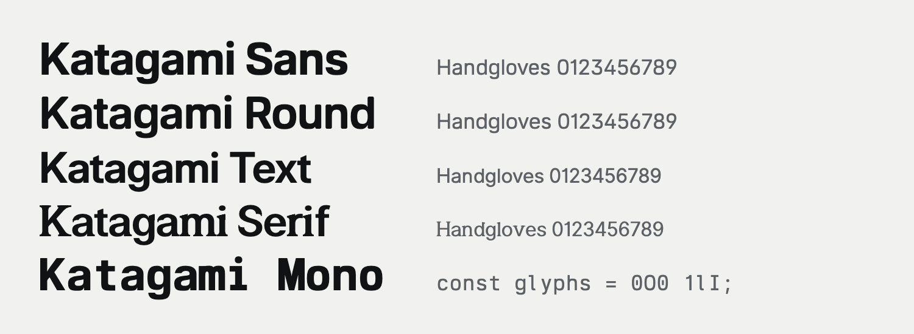

# Katagami


Katagami is a free, open-source type family in five members that share one skeleton: a sans for interfaces, a rounded sans, a reading face, a serif and a monospace. Every member is a variable font with a weight axis, and the proportional members set 22 scripts plus Chinese, Japanese and Korean.

**Site:** [katagami.kevinliu.studio](https://katagami.kevinliu.studio) has the [glyphs](https://katagami.kevinliu.studio/glyphs), the [features](https://katagami.kevinliu.studio/features), a [map of where it writes](https://katagami.kevinliu.studio/map), [Font-ify](https://katagami.kevinliu.studio/convert) for seeing any site in Katagami, and the [download](https://katagami.kevinliu.studio/download).



## Members

| Member | For | Weights | Glyphs | File |
|---|---|---|---|---|
| **Katagami Sans** | Interfaces and display: squared curves, level cuts, square punctuation | 100 to 900 | 11,242 | `fonts/sans/KatagamiSans[wght].ttf` |
| **Katagami Round** | Softer interfaces: bowls squared less, every vertex rounded at 0.22 stems | 100 to 900 | 11,243 | `fonts/round/KatagamiRound[wght].ttf` |
| **Katagami Text** | Long reading: x-height 0.71 of the caps, set 4 percent smaller, tighter, a closer c and a straight l | 100 to 900 | 11,243 | `fonts/text/KatagamiText[wght].ttf` |
| **Katagami Serif** | Reading with serifs: Text with bracketed serifs, slanted heads and a light contrast | 100 to 900 | 11,243 | `fonts/serif/KatagamiSerif[wght].ttf` |
| **Katagami Mono** | Code and terminals: a 0.625 em cell, every confusable character distinct, opt-in code ligatures | 100 to 700 | 3,507 | `fonts/mono/KatagamiMono[wght].ttf` |

Every weight from Thin to Black (Mono Thin to Bold) is a named instance, so apps that do not handle variable fonts list them as styles.

All five share the same decisions: level cuts on c, e, s, a and g, a g whose tail mirrors its bowl, y and t tails that end in vertical cuts, and an f whose crossbar reaches the same distance past its stem at every weight.

## Coverage

- **Drawn:** Latin, Greek and Cyrillic.
- **Merged:** 19 more scripts, from Devanagari, Bengali and Tamil to Arabic, Hebrew, Thai, Ethiopic and Khmer, merged from Noto Sans and scaled to Katagami's x-height. Each proportional member maps 6,580 characters in all.
- **Companions:** Katagami CJK SC (7,768 characters), TC (14,154), JP (7,359) and KR (12,422), from Noto Sans SC, TC, JP and KR, which the web stylesheet assigns to Sans, Round, Text and Serif.

Together they set the main language of places where 99.9 percent of people live. The [map](https://katagami.kevinliu.studio/map) shows where, and lists the 11 languages that are not covered yet.

## OpenType features

Every feature Inter has works in every member, with labels in the font: tabular and proportional figures, fractions, superiors and inferiors, ordinals, the slashed zero, case-sensitive forms, 16 character variants and 8 stylistic sets. Katagami adds small capitals (`smcp`, `c2sc`) and, in Katagami Mono, code ligatures for `->`, `=>`, `!=`, `==` and `>=` that keep every character in its own cell (`dlig`). The [features page](https://katagami.kevinliu.studio/features) shows each one off and on.

## Use it

Download the fonts from the [download page](https://katagami.kevinliu.studio/download) or from `fonts/` here. On the web, link the stylesheet; each script is its own file, so a page loads only what it shows.

```html
<link rel="stylesheet" href="https://katagami.kevinliu.studio/fonts/katagami.css">
```

```css
body { font-family: "Katagami Sans", system-ui, sans-serif; }
code { font-family: "Katagami Mono", ui-monospace, monospace; }
```

## How it is made

Katagami is generated. The build scripts in `tools/` take Inter's sources, apply each member's transforms to its Thin, Regular and Black masters with the points kept compatible, and compile variable fonts with fontmake. Nothing is drawn by hand yet. [SPEC.md](SPEC.md) records every decision and its numbers:

- **Sans** squares bowls toward their corners (upper 0.36, lower 0.32), condenses round letters so o matches n, cuts terminals level and makes punctuation square.
- **Round** squares about two thirds as far as Sans and rounds every sharp vertex at 0.22 stems.
- **Text** lowers the x-height to 0.71 of the caps, sets everything 4 percent smaller, tightens spacing, widens round letters and capitals, and condenses letters to 0.97 of their ink width with stems kept.
- **Serif** is Text with bracketed serifs cut onto its stroke ends: each runs flat 0.65 of a stem past the stroke to a short flat end and curves back into the stroke's own side, as thick as the H crossbar where it meets it. Lowercase heads are cut on a slant, and arms and level terminals take spurs. Every point keeps its x and moves 0.3 of the way to its height in the next lighter master, which thins the horizontals.
- **Mono** fits Sans to a 1280-unit cell, holds the stems, stretches the arms of f, t, r and J into the cell, and draws the box-drawing block from Unicode names.
- **Thin** keeps a floor: where squaring would thin a stroke below 0.8 of Inter's, the curve is eased back.

## Building

Requires Python 3.11 or later and git.

```bash
python3 -m venv .venv
.venv/bin/pip install -r requirements.txt
tools/build.sh          # every member and the CJK companions
tools/build.sh sans     # one member: sans, round, text, serif, mono or cjk
```

The build fetches Inter's sources at a pinned commit into `vendor/inter` and Noto Sans into `vendor/noto`. Each proportional member takes 15 to 40 minutes on a busy machine, most of it in fontmake and the script merge, and Mono takes a few minutes after Sans.

After a build, `tools/build_site.py` writes the website's web fonts, data, download zip and pages into a checkout of [Katagami-Website](https://github.com/Kevin-Liu-01/Katagami-Website) next to this repo (or at `KATAGAMI_SITE`), and `tools/build_map.py` writes the map data. `tools/build_site.py --pages` rewraps the pages only. Then `tools/build_seo.py` writes the library pages and the files for search and answer engines, and `node tools/og.mjs` draws the social cards.

## Layout

| Path | Contents |
|---|---|
| `fonts/` | the built fonts: one variable TTF per member and the four CJK companions |
| `tools/kerf_build/profiles.py` | the parameters of Sans, Round, Text and Serif |
| `tools/build_sans.py` | Inter's masters to a proportional member's masters, including Serif's serifs and contrast |
| `tools/build_mono.py` | Katagami Sans's masters to Katagami Mono's |
| `tools/build_world.py` | merges the 19 scripts into a proportional member and restores its metrics and feature labels |
| `tools/build_cjk.py` | the Katagami CJK SC, TC, JP and KR companions |
| `tools/kerf_build/outline.py` | point-preserving transforms: squaring, emboldening, stroke measurement, rounded corners |
| `tools/kerf_build/fontops.py` | glyph swaps, resizing, spacing, composite re-seating, naming |
| `tools/kerf_build/boxdraw.py` | box drawing and block elements |
| `tools/build_site.py` | the website's fonts, data, downloads and pages |
| `tools/build_map.py` | the map data and coverage figures |
| `tools/build_seo.py` | the library pages kept out of the navigation (a page per member, comparisons, guides, explainers, a page per script and per language), their Markdown twins, `llms.txt`, `llms-full.txt`, the sitemap and `robots.txt` |
| `tools/seo/typefaces.json` | facts about the typefaces the comparisons name, each with its sources |
| `tools/og.mjs` | the 1200 by 630 social cards, set in Katagami |
| `tools/logo.py` | the mark: a square cut three times, whose leftover piece is the K |
| `SPEC.md` | every design decision and its numbers |

## Status

Version 0.1 is a generated draft. Next come hand corrections (a flat-topped t, a straight Q tail, a squarer 2), italics, hinting with fontbakery checks, and Greek and Cyrillic in the mono.

## Credits

Katagami starts from [Inter](https://github.com/rsms/inter) by Rasmus Andersson, and its merged scripts and CJK companions come from [Noto](https://github.com/notofonts), both under the SIL Open Font License. Camber (Eduardo Manso, Emtype Foundry), Berkeley Mono (U.S. Graphics), PP Mori (Pangram Pangram) and NewsSerif (Henning Skibbe, Character Type) were measured as references for proportion, curve shape, the mono cell and the serifs; Katagami contains none of their outlines.

The name comes from katagami (型紙, "pattern paper"), the Japanese paper stencils cut to dye patterns on cloth.

## License

Katagami is licensed under the [SIL Open Font License 1.1](OFL.txt). It is a modified version of Inter and keeps Inter's and Noto's copyright notices.
