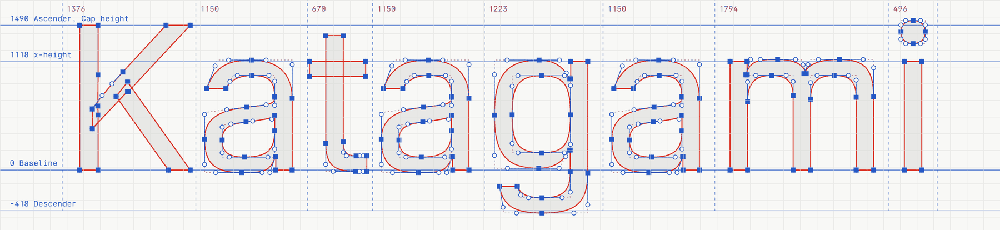
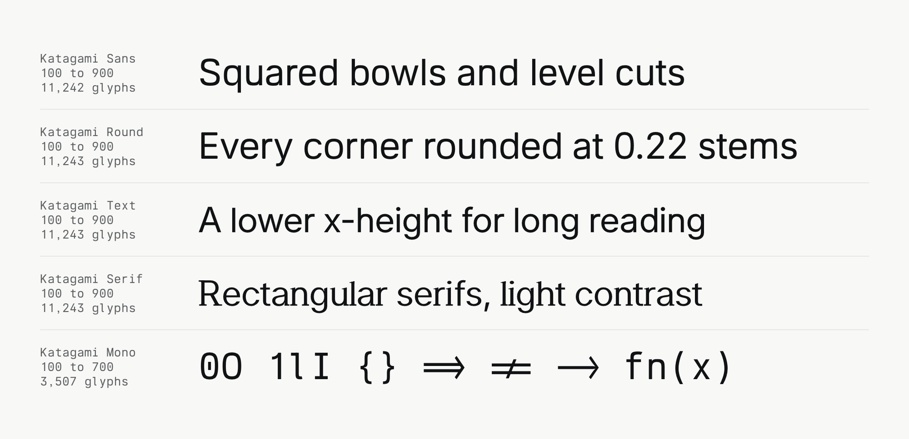
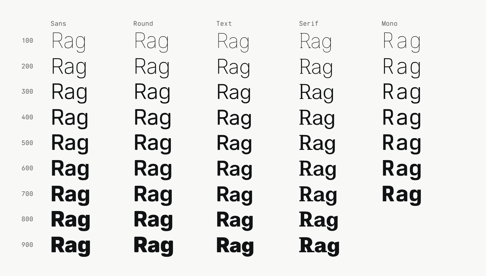
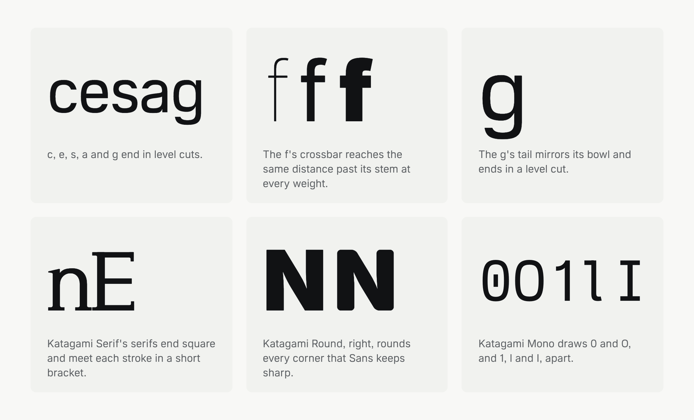
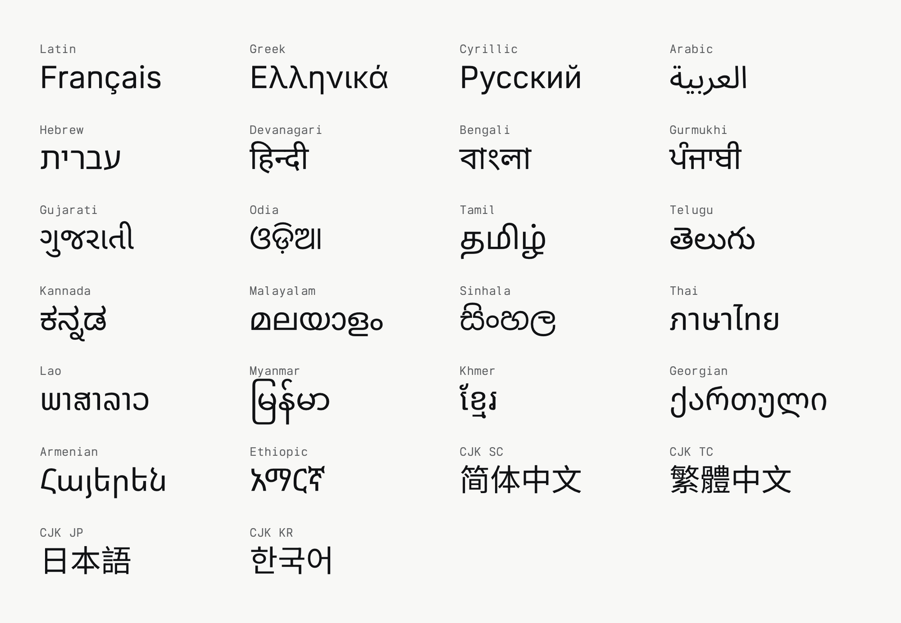
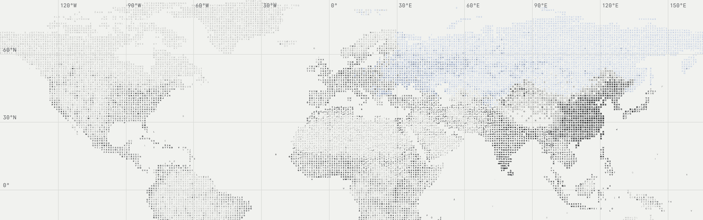
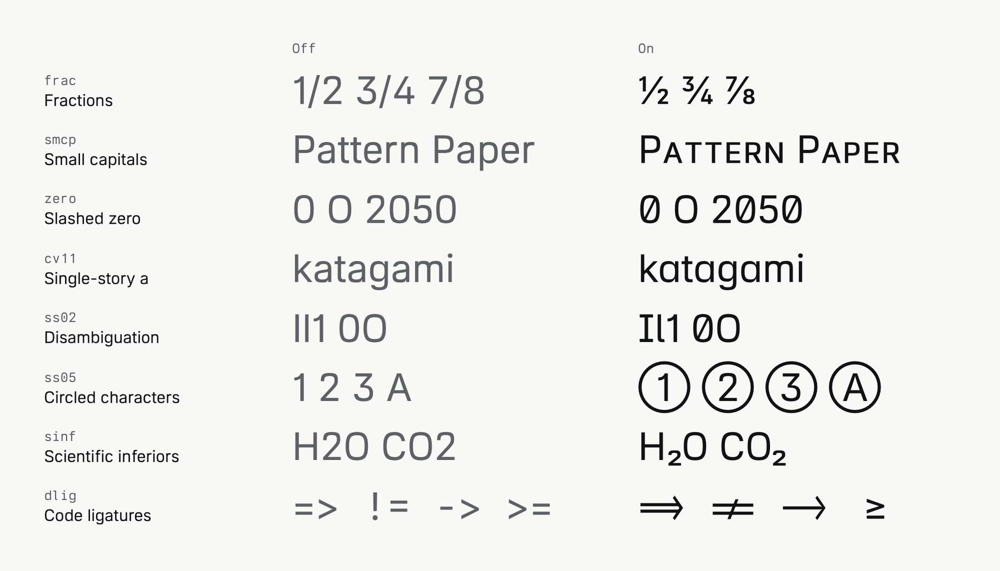
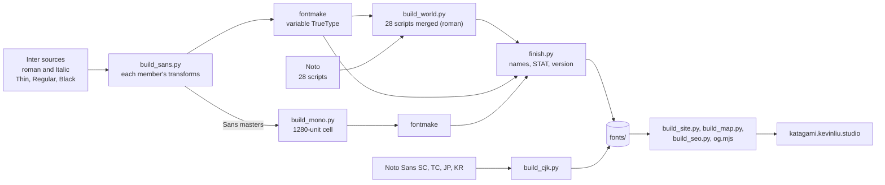

<p align="center">
  <picture>
    <source media="(prefers-color-scheme: dark)" srcset="docs/logo/katagami-logo-dark.svg">
    
  </picture>
</p>

<p align="center">
  A free type family in five members that share one skeleton.<br>
  <a href="https://katagami.kevinliu.studio">Site</a> ·
  <a href="https://katagami.kevinliu.studio/glyphs">Glyphs</a> ·
  <a href="https://katagami.kevinliu.studio/features">Features</a> ·
  <a href="https://katagami.kevinliu.studio/map">Map</a> ·
  <a href="https://katagami.kevinliu.studio/convert">Font-ify</a> ·
  <a href="https://katagami.kevinliu.studio/download">Download</a>
</p>

<picture>
  <source media="(prefers-color-scheme: dark)" srcset="docs/readme/hero-dark.png">
  
</picture>

Katagami is a free, open-source type family: Katagami Sans for interfaces, Katagami Round for softer interfaces, Katagami Text for long reading, Katagami Serif, and Katagami Mono for code. Each member is a variable roman and a variable Italic with a weight axis. The four proportional members set Latin, Greek, Cyrillic and 28 more scripts, and four companion fonts add Chinese, Japanese and Korean. The fonts are released under the SIL Open Font License 1.1, so you can use them in any product, change them and ship them.

The drawing above is the first thing on [the website](https://katagami.kevinliu.studio). A slider there morphs the word through all five members, and every point can be dragged.

## Members

<picture>
  <source media="(prefers-color-scheme: dark)" srcset="docs/readme/members-dark.png">
  
</picture>

| Member | For | Weights | Glyphs | Files |
|---|---|---|---|---|
| **Katagami Sans** | Interfaces and display: squared bowls, level cuts and square punctuation | 100 to 900 | 15,211 and 3,725 | `fonts/sans/KatagamiSans[wght].ttf`, `KatagamiSans-Italic[wght].ttf` |
| **Katagami Round** | Softer interfaces: bowls squared less, every corner rounded at 0.22 stems | 100 to 900 | 15,211 and 3,725 | `fonts/round/KatagamiRound[wght].ttf`, `KatagamiRound-Italic[wght].ttf` |
| **Katagami Text** | Long reading: an x-height 0.71 of the caps, set 4 percent smaller and tighter | 100 to 900 | 15,212 and 3,725 | `fonts/text/KatagamiText[wght].ttf`, `KatagamiText-Italic[wght].ttf` |
| **Katagami Serif** | Reading with serifs: Text with rectangular serifs, triangular heads and moderate contrast | 100 to 900 | 15,212 and 3,725 | `fonts/serif/KatagamiSerif[wght].ttf`, `KatagamiSerif-Italic[wght].ttf` |
| **Katagami Mono** | Code and terminals: a 0.625 em cell, every confusable character drawn apart, opt-in code ligatures | 100 to 700 | 4,123 and 4,123 | `fonts/mono/KatagamiMono[wght].ttf`, `KatagamiMono-Italic[wght].ttf` |

The Glyphs column gives the roman's count, then the Italic's. The romans carry the merged scripts; the Italics carry Latin, Greek and Cyrillic.

## Weights

<picture>
  <source media="(prefers-color-scheme: dark)" srcset="docs/readme/weights-dark.png">
  
</picture>

Every weight from Thin (100) to Black (900) is a named instance, and Mono runs from Thin to Bold (700). Each has an Italic at the same weights, from Thin Italic to Black Italic. Apps that do not handle variable fonts list each weight as its own style.

## Details

<picture>
  <source media="(prefers-color-scheme: dark)" srcset="docs/readme/details-dark.png">
  
</picture>

The five members share these decisions. [SPEC.md](SPEC.md) records each one with its numbers.

## Scripts and languages

<picture>
  <source media="(prefers-color-scheme: dark)" srcset="docs/readme/scripts-dark.png">
  
</picture>

- **Drawn:** Latin, Greek and Cyrillic.
- **Merged:** Arabic, Hebrew, Devanagari, Bengali, Gurmukhi, Gujarati, Odia, Tamil, Telugu, Kannada, Malayalam, Sinhala, Thai, Lao, Myanmar, Khmer, Georgian, Armenian, Ethiopic, Tifinagh, Ol Chiki, Coptic, Tibetan, Hanifi Rohingya, N'Ko, Thaana, Vai and Canadian Aboriginal syllabics, merged from Noto and scaled to Katagami's x-height. Tibetan comes from Noto Serif Tibetan, the only Noto Tibetan. Each proportional member maps 8,346 characters.
- **Italics:** the Italics set Latin, Greek and Cyrillic. For italic text in another script, a stylesheet declares the roman's script files a second time with `font-style: italic`, so the roman's letters set it.
- **Companions:** Katagami CJK SC (8,138 characters), TC (14,524), JP (7,729) and KR (12,792), built from Noto Sans SC, TC, JP and KR. The web stylesheet assigns them to Sans, Round, Text and Serif.

<picture>
  <source media="(prefers-color-scheme: dark)" srcset="docs/readme/map-dark.png">
  
</picture>

Together they set the main language of every place on the [map](https://katagami.kevinliu.studio/map), and all 234 of its languages in full. The map draws each land cell as a letter of the language spoken there.

## OpenType features

<picture>
  <source media="(prefers-color-scheme: dark)" srcset="docs/readme/features-dark.png">
  
</picture>

Every member carries Inter's features with their labels: tabular and proportional figures, fractions, superiors and inferiors, ordinals, the slashed zero, case-sensitive forms, 16 character variants and 8 stylistic sets. Katagami adds small capitals (`smcp`, `c2sc`). Katagami Mono adds code ligatures for `->`, `=>`, `!=`, `==` and `>=` (`dlig`), and each character in a ligature keeps its own cell. The [features page](https://katagami.kevinliu.studio/features) shows every feature off and on, with the CSS to turn it on.

## Use it

**On a computer.** Download the zip from the [download page](https://katagami.kevinliu.studio/download), or take the files from `fonts/` here, and install the `.ttf` files the way your system installs fonts. The download page has the steps for macOS, Windows and Linux.

**On the web.** Link the stylesheet, then name the family in your CSS. Each member is one family split by script, so a page downloads only the scripts it shows, and the files are served with `Access-Control-Allow-Origin: *`.

```html
<link rel="stylesheet" href="https://katagami.kevinliu.studio/fonts/katagami.css">
```

```css
body { font-family: "Katagami Sans", system-ui, sans-serif; }
article { font-family: "Katagami Serif", ui-serif, serif; }
code { font-family: "Katagami Mono", ui-monospace, monospace; }
.price { font-feature-settings: "tnum"; }
```

**On any page you are reading.** [Font-ify](https://katagami.kevinliu.studio/convert) shows any website set in Katagami next to the original, and its bookmarklet does the same on the page you are on.

## How it is made

Katagami is generated. Nothing is drawn by hand yet: build scripts take Inter's roman and Italic sources, apply each member's transforms to their Thin, Regular and Black masters with every point kept compatible, and compile variable fonts with fontmake.



- **Sans** squares bowls toward their corners (0.36 for capitals, 0.32 for lowercase), condenses round letters so o matches n, cuts terminals level and makes punctuation square.
- **Round** squares about two thirds as far as Sans and rounds every sharp corner at 0.22 stems.
- **Text** lowers the x-height to 0.71 of the caps, sets everything 4 percent smaller, tightens spacing, widens round letters and capitals, and condenses letters to 0.97 of their ink width with stems kept.
- **Serif** is Text with rectangular serifs cut onto its stroke ends, after the design notes of Signifier. Each serif runs 0.85 of a stem past the stroke, ends square at 0.8 of the H crossbar's thickness (as thick as the hairlines at Thin, a third of the stem at Black), and meets the stroke's own side in a short bracket. Lowercase heads are triangular, the arms of E, F, L, T and Z take short vertical serifs, curved terminals (C, G, S, c, s, a, e, the figures) and the ends of r, f, t, j and y take vertical beaks as thick and as long as the serifs, and every point moves 0.6 of the way to its height in the next lighter master at Regular and 0.3 at Black, which thins the horizontals. Letters whose serifs would pass their sidebearings, such as v, y and A, are narrowed instead of widened, so the spacing stays even.
- **Italics** start from Inter Italic's masters. Each is stood upright by 9.4 degrees, run through its member's transforms and slanted again. Every Italic glyph is its roman's design slanted: where Inter Italic draws a letter differently (its f, its single-storey a and others), the roman's glyph is slanted instead, and the Italic takes the roman's features and kerning. Serif Italic's serifs sit where the roman's do; Mono Italic's box drawing and Braille stay upright.
- **Mono** fits Sans to a 1280-unit cell, keeps the stems, stretches the arms of f, t, r and J into the cell, fits Greek and Cyrillic by the same rules, and draws the box-drawing block from Unicode names. It also draws all 256 Braille patterns, U+2800 to U+28FF, and the status symbols coding agents print in the terminal, such as ⏺, ⎿, ✔ and ✻, so spinners and panels never fall back to another font.
- **Thin** keeps a floor: where squaring would thin a stroke below 0.8 of Inter's, the curve is eased back.

## Building

Python 3.11 or later and git are required.

```bash
python3 -m venv .venv
.venv/bin/pip install -r requirements.txt
tools/build.sh                # every member, roman and Italic, and the CJK companions
tools/build.sh serif          # one member: sans, round, text, serif, mono or cjk
tools/build.sh serif-italic   # one member's Italic (or serif-roman)
```

The build fetches Inter's sources at a pinned commit into `vendor/inter` and Noto Sans into `vendor/noto`. A proportional member takes 15 to 40 minutes on a busy machine, most of it in fontmake and the script merge. Mono takes a few minutes after Sans.

After a build, these commands write the website into a checkout of [Katagami-Website](https://github.com/Kevin-Liu-01/Katagami-Website) next to this repository, or at `KATAGAMI_SITE`. The website is a Next.js app that renders the page records these commands write.

| Command | What it writes |
|---|---|
| `.venv/bin/python tools/build_site.py` | the web fonts, `data.js` and the download zip in `public/`, and a record in `content/pages/` for every page; `--pages` writes only the records |
| `.venv/bin/python tools/build_map.py` | the map's grids and coverage figures |
| `.venv/bin/python tools/build_seo.py` | the library page records, the Markdown twins, `llms.txt`, the sitemap and `robots.txt` |
| `node tools/og.mjs` | the 1200 by 630 social cards |
| `node tools/readme.mjs` | the images in this README and the website's, drawn from the site served at `BASE`; `python3 tools/readme_shrink.py` then reduces them |

## Repository

| Path | Contents |
|---|---|
| `fonts/` | the built fonts: a variable roman and Italic TTF per member and the four CJK companions |
| `tools/kerf_build/profiles.py` | the parameters of Sans, Round, Text and Serif |
| `tools/build_sans.py` | Inter's masters to a proportional member's, including Serif's serifs and contrast |
| `tools/build_mono.py` | Katagami Sans's masters to Katagami Mono's |
| `tools/build_world.py` | merges the 28 scripts into a member and restores its metrics and feature labels |
| `tools/finish.py` | names, STAT, style bits, version, line metrics and the gasp and prep tables of the built fonts |
| `tools/build_cjk.py` | the Katagami CJK SC, TC, JP and KR companions |
| `tools/kerf_build/outline.py` | point-preserving transforms: squaring, emboldening, stroke measurement, rounded corners |
| `tools/kerf_build/fontops.py` | glyph swaps, resizing, spacing, composite re-seating, naming |
| `tools/kerf_build/boxdraw.py` | box drawing and block elements |
| `tools/kerf_build/terminal.py` | Braille patterns and the status symbols coding agents print |
| `tools/build_site.py`, `tools/build_map.py`, `tools/build_seo.py` | the website: fonts, data, pages, map, library pages and the files for search and answer engines |
| `tools/seo/typefaces.json` | facts about the typefaces the comparison pages name, each with its sources |
| `tools/og.mjs`, `tools/readme.mjs` | the social cards and the README images |
| `tools/logo.py` | the mark: a square cut three times, whose leftover piece is the K |
| `docs/` | the logo and the README images |
| `SPEC.md` | every design decision and its numbers |

## Status

Version 0.2 adds an Italic for every member, a reworked Katagami Serif (serifs that hold at Thin, a lighter Black, crisper brackets, even spacing and beaks on its curved terminals), two hand corrections (a straight Q tail and a squarer 2), Greek and Cyrillic fitted to Katagami Mono's cell, nine more scripts, the 93 characters Google Fonts' case and language checks ask for, small capitals for 620 letters, accents that attach to Cyrillic and Greek letters, and fixes for fontbakery's naming, STAT, gasp, prep, version and clipping checks. Next come hinting and redrawing the 28 merged scripts in Katagami's style.

## Credits

Katagami starts from [Inter](https://github.com/rsms/inter) by Rasmus Andersson. Its merged scripts and CJK companions come from [Noto](https://github.com/notofonts), and both are under the SIL Open Font License. Camber (Eduardo Manso, Emtype Foundry), Berkeley Mono (U.S. Graphics), PP Mori (Pangram Pangram) and NewsSerif (Henning Skibbe, Character Type) were measured as references for proportion, curve shape, the mono cell and the first serifs. The serif shapes follow the design notes of Signifier (Kris Sowersby, Klim Type Foundry). Katagami contains none of their outlines.

The name comes from katagami (型紙, "pattern paper"), the Japanese paper stencils cut to dye patterns on cloth.

## License

Katagami is licensed under the [SIL Open Font License 1.1](OFL.txt). It is a modified version of Inter and keeps Inter's and Noto's copyright notices.
