<p align="center">
  <picture>
    <source media="(prefers-color-scheme: dark)" srcset="docs/logo/katagami-logo-dark.svg">
    
  </picture>
</p>

<p align="center">
  A free type family in five members that share one skeleton.<br>
  <a href="https://katagami.kevinliu.studio">Site</a> ·
  <a href="https://katagami.kevinliu.studio/glyphs">Glyphs</a> ·
  <a href="https://katagami.kevinliu.studio/features">Features</a> ·
  <a href="https://katagami.kevinliu.studio/map">Map</a> ·
  <a href="https://katagami.kevinliu.studio/convert">Font-ify</a> ·
  <a href="https://katagami.kevinliu.studio/about">About</a> ·
  <a href="https://katagami.kevinliu.studio/faq">FAQ</a> ·
  <a href="https://katagami.kevinliu.studio/download">Download</a>
</p>

<picture>
  <source media="(prefers-color-scheme: dark)" srcset="docs/readme/hero-dark.png">
  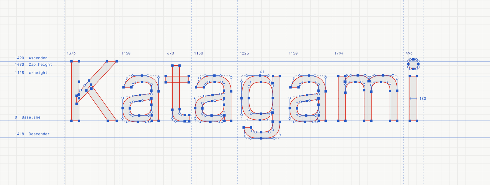
</picture>

Katagami is a free, open-source type family in five members. Katagami Sans is for interfaces, Katagami Round for softer interfaces, Katagami Text for long reading, Katagami Serif for reading with serifs and Katagami Mono for code. Each member is a variable roman and a variable Italic with a weight axis, and all five set their lines on the same metrics. The four proportional members set Latin, Greek, Cyrillic and 28 more scripts, and four companion fonts add Chinese, Japanese and Korean. One stylesheet sets all 234 languages on the site's map, each in roman and Italic. The fonts are released under the SIL Open Font License 1.1, so you can use them in any product, change them and ship them.

[generaltranslation.com](https://generaltranslation.com) sets its text in Katagami Text.

The drawing above is the first thing on [the website](https://katagami.kevinliu.studio). A slider there morphs the word through all five members, Play sweeps it across the family, and every point can be dragged.

## Members

<picture>
  <source media="(prefers-color-scheme: dark)" srcset="docs/readme/members-dark.png">
  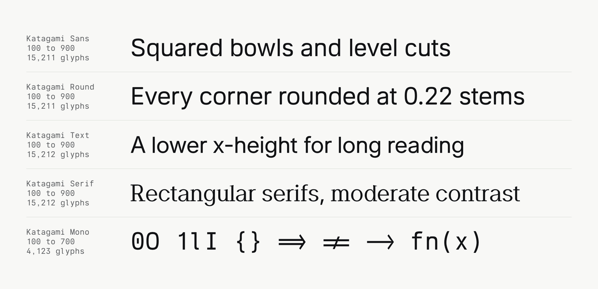
</picture>

| Member | For | Weights | Glyphs | Files |
|---|---|---|---|---|
| **Katagami Sans** | Interfaces and display: squared bowls, level cuts and square punctuation | 100 to 900 | 15,211 and 15,212 | `fonts/sans/KatagamiSans[wght].ttf`, `KatagamiSans-Italic[wght].ttf` |
| **Katagami Round** | Softer interfaces: bowls squared less, every corner rounded at 0.22 stems | 100 to 900 | 15,211 and 15,212 | `fonts/round/KatagamiRound[wght].ttf`, `KatagamiRound-Italic[wght].ttf` |
| **Katagami Text** | Long reading: an x-height 0.71 of the caps, set 4 percent smaller and tighter | 100 to 900 | 15,212 and 15,212 | `fonts/text/KatagamiText[wght].ttf`, `KatagamiText-Italic[wght].ttf` |
| **Katagami Serif** | Reading with serifs: Text with rectangular serifs, triangular heads and moderate contrast | 100 to 900 | 15,212 and 15,212 | `fonts/serif/KatagamiSerif[wght].ttf`, `KatagamiSerif-Italic[wght].ttf` |
| **Katagami Mono** | Code and terminals: a 0.625 em cell, every confusable character drawn apart, opt-in code ligatures | 100 to 700 | 4,123 and 4,123 | `fonts/mono/KatagamiMono[wght].ttf`, `KatagamiMono-Italic[wght].ttf` |

The Glyphs column gives the roman's count, then the Italic's. Each Italic maps every character its roman maps.

## One set of line metrics

<picture>
  <source media="(prefers-color-scheme: dark)" srcset="docs/readme/lines-dark.png">
  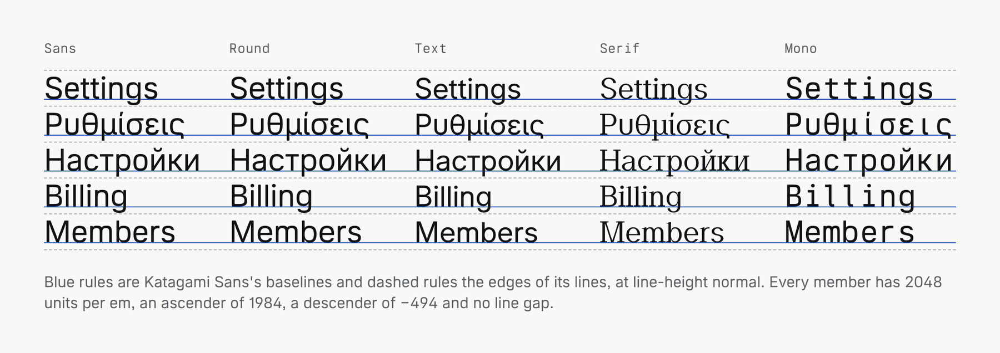
</picture>

All ten member files have 2048 units per em, an ascender of 1984, a descender of −494 and no line gap. These are Inter's line metrics, and as in Inter the fonts ask apps to space lines by them (`USE_TYPO_METRICS`). A page that switches from one member to another, or from Inter to Katagami, keeps every line height. The CJK companions draw the same line at their own 1000 units per em, 969 above the baseline and 241 below, so Chinese, Japanese and Korean set on it too.

## Weights

<picture>
  <source media="(prefers-color-scheme: dark)" srcset="docs/readme/weights-dark.png">
  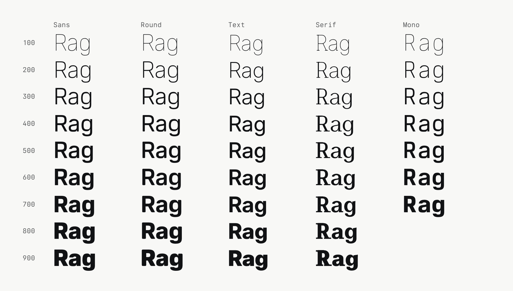
</picture>

Every weight from Thin (100) to Black (900) is a named instance, and Mono runs from Thin to Bold (700). Each has an Italic at the same weights, from Thin Italic to Black Italic. Apps that do not handle variable fonts list each weight as its own style.

## Details

<picture>
  <source media="(prefers-color-scheme: dark)" srcset="docs/readme/details-dark.png">
  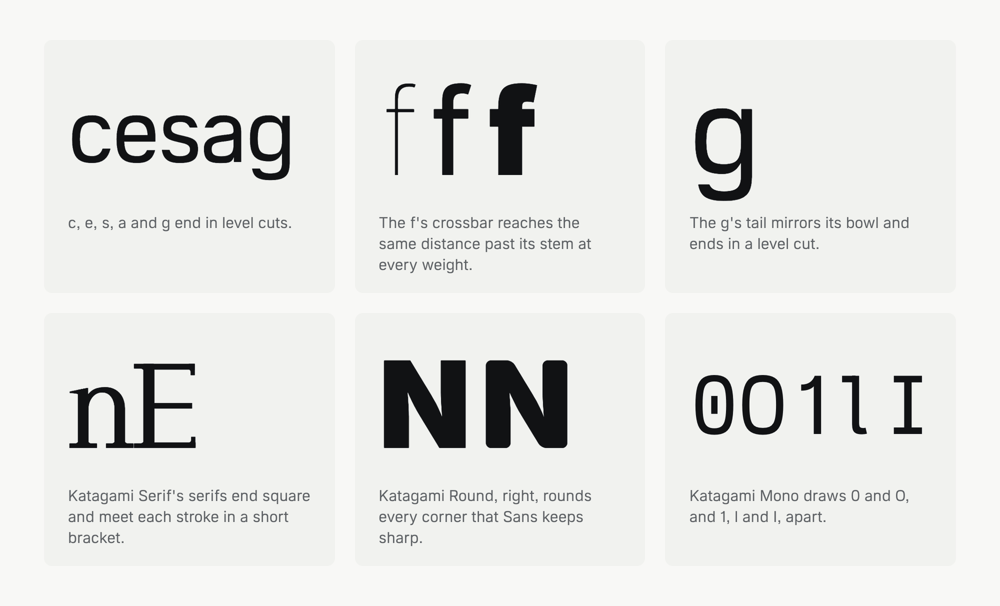
</picture>

The five members share these decisions. [SPEC.md](SPEC.md) records each one with its numbers.

## Scripts and languages

<picture>
  <source media="(prefers-color-scheme: dark)" srcset="docs/readme/languages-dark.png">
  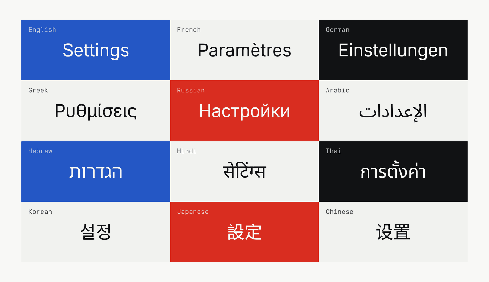
</picture>

This is the word settings in twelve languages, all set from the one stylesheet in [Use it](#use-it). Katagami Sans draws the Latin, Greek and Cyrillic, the merged scripts set the Arabic, Hebrew, Hindi and Thai, and the CJK companions set the Korean, Japanese and Chinese.

<picture>
  <source media="(prefers-color-scheme: dark)" srcset="docs/readme/scripts-dark.png">
  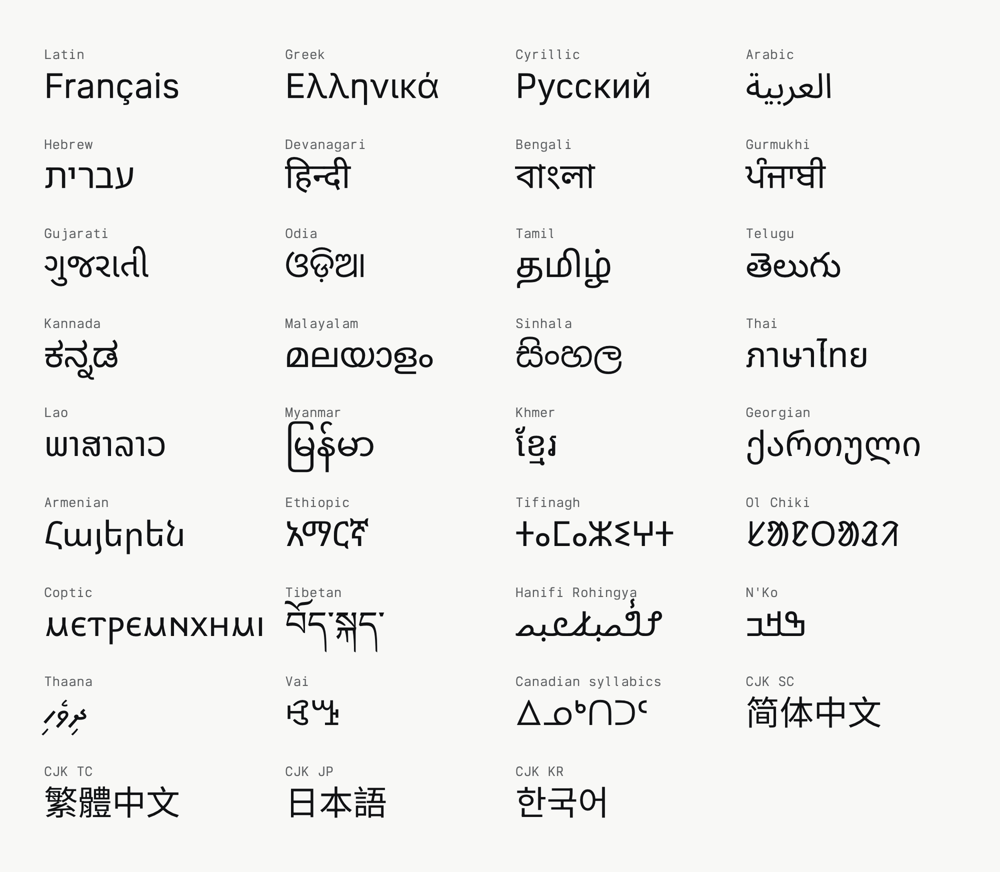
</picture>

- **Drawn:** Latin, Greek and Cyrillic.
- **Merged:** Arabic, Hebrew, Devanagari, Bengali, Gurmukhi, Gujarati, Odia, Tamil, Telugu, Kannada, Malayalam, Sinhala, Thai, Lao, Myanmar, Khmer, Georgian, Armenian, Ethiopic, Tifinagh, Ol Chiki, Coptic, Tibetan, Hanifi Rohingya, N'Ko, Thaana, Vai and Canadian Aboriginal syllabics, merged from Noto and scaled to Katagami's x-height. Tibetan comes from Noto Serif Tibetan, the only Noto Tibetan. Each proportional member maps 8,346 characters.
- **Companions:** Katagami CJK SC (8,138 characters), TC (14,524), JP (7,729) and KR (12,792), built from Noto Sans SC, TC, JP and KR. The web stylesheet assigns them to Sans, Round, Text and Serif.

### An Italic for every script

<picture>
  <source media="(prefers-color-scheme: dark)" srcset="docs/readme/italics-dark.png">
  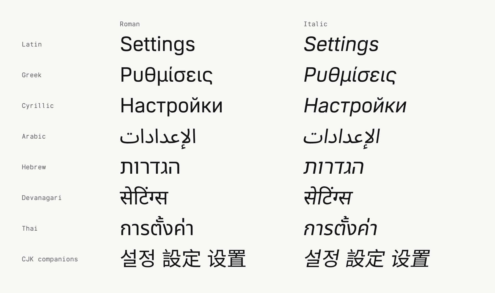
</picture>

Each Italic sets every script its roman sets. A merged script's Italic is its roman slanted 9.4 degrees, as the Latin is, and the right-to-left scripts lean right like the rest. Each CJK companion has an Italic too, its roman slanted the same 9.4 degrees. The web stylesheet serves every Italic, so `<em>` sets an Italic in Arabic, Devanagari or Japanese as it does in English.

### The map

<picture>
  <source media="(prefers-color-scheme: dark)" srcset="docs/readme/map-dark.png">
  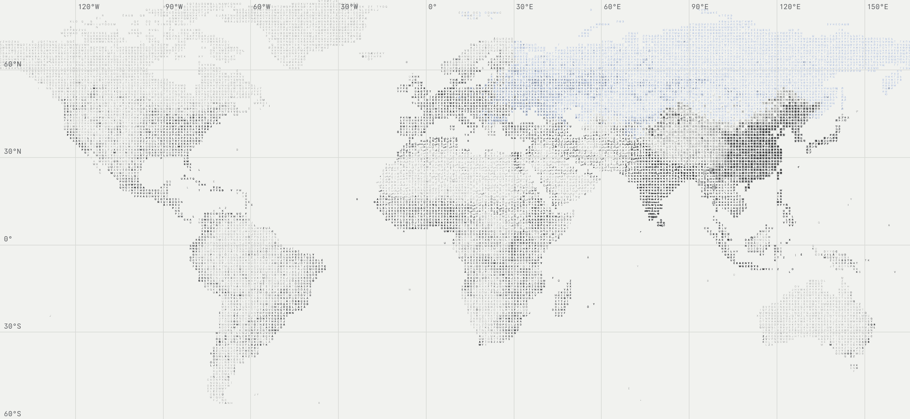
</picture>

Together they set the main language of every place on the [map](https://katagami.kevinliu.studio/map), and all 234 of its languages in full. The map draws each land cell as a letter of the language spoken there, and its Globe view shades the same coverage on a globe that turns under a drag.

## Katagami Mono in the terminal

<picture>
  <source media="(prefers-color-scheme: dark)" srcset="docs/readme/terminal-dark.png">
  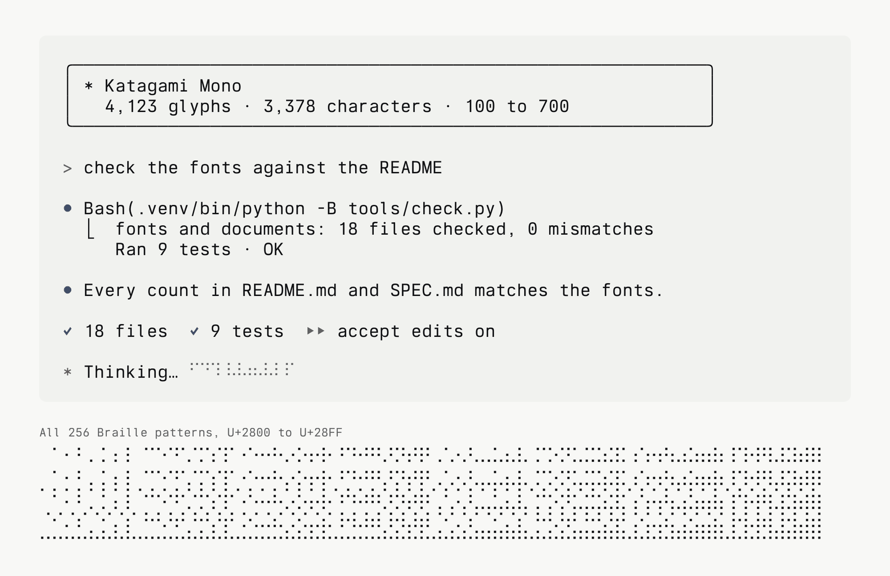
</picture>

Katagami Mono draws the box-drawing and block elements, all 256 Braille patterns and the 15 status symbols that coding agents such as Claude Code print, among them ⏺︎, ⎿, ✔ and ✻, each in one cell at every weight. A session in a terminal set in Katagami Mono never falls back to another font for its panels, status symbols or spinners. Box drawing spans the full line height, so its lines join from row to row at a line height of 1.21, and the Braille dots spread evenly over the same height. [Fonts in coding agents](https://katagami.kevinliu.studio/learn/fonts-in-coding-agents) gives each terminal's setting.

## OpenType features

<picture>
  <source media="(prefers-color-scheme: dark)" srcset="docs/readme/features-dark.png">
  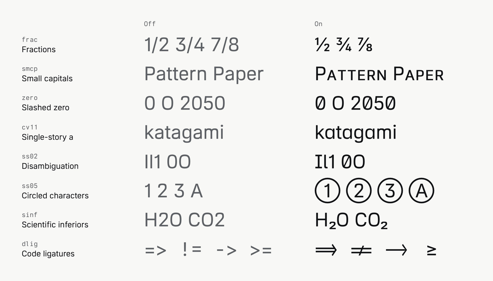
</picture>

Every member carries Inter's features with their labels, among them tabular and proportional figures, fractions, superiors and inferiors, ordinals, the slashed zero, case-sensitive forms, 16 character variants and 8 stylistic sets. Katagami adds small capitals (`smcp`, `c2sc`) for 620 letters. Katagami Mono adds code ligatures for `->`, `<-`, `=>`, `!=`, `==`, `===`, `!==`, `>=` and `<=` (`dlig`), and each character in a ligature keeps its own cell. The ligatures stay off until you turn them on. The [features page](https://katagami.kevinliu.studio/features) shows every feature off and on, with the CSS to turn it on.

## Use it

**On a computer.** Download the zip from the [download page](https://katagami.kevinliu.studio/download) or from the [latest release](https://github.com/Kevin-Liu-01/Katagami/releases/latest), or take the files from `fonts/` here, and install the `.ttf` files the way your system installs fonts. The download page has the steps for macOS, Windows and Linux.

**On the web.** Link the stylesheet, then name the family in your CSS. Each member is one family split by script, roman and Italic, so a page downloads only the scripts and styles it shows. The files are served with `Access-Control-Allow-Origin: *`.

```html
<link rel="stylesheet" href="https://katagami.kevinliu.studio/fonts/katagami.css">
```

```css
body { font-family: "Katagami Sans", system-ui, sans-serif; }
article { font-family: "Katagami Serif", ui-serif, serif; }
code { font-family: "Katagami Mono", ui-monospace, monospace; }
.price { font-feature-settings: "tnum"; }
```

**On any page you are reading.** [Font-ify](https://katagami.kevinliu.studio/convert) shows any website set in Katagami next to the original, and its bookmarklet does the same on the page you are on.

**For an agent.** Every page on the site has a Markdown twin at the same address with `.md`, and [llms.txt](https://katagami.kevinliu.studio/llms.txt) indexes them.

## How it is made

Katagami is generated, and nothing is drawn by hand yet. Build scripts take Inter's roman and Italic sources, apply each member's transforms to their Thin, Regular and Black masters with every point kept compatible, and compile variable fonts with fontmake.

Sans, Round, Text and Serif are four profiles in [`tools/kerf_build/profiles.py`](tools/kerf_build/profiles.py), and each profile is a set of numbers for the same transforms. Sans moves the bowls of its capitals 0.36 of the way toward their corners, Round 0.24 and Text −0.02, which leaves Text's bowls a touch rounder than Inter's. Serif is Text with serifs that reach 0.85 stroke widths past each stroke. Mono is fitted from Sans's masters by `tools/build_mono.py`. [SPEC.md](SPEC.md) explains every number.

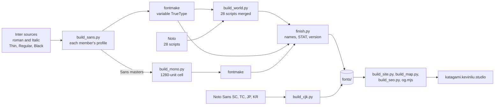

- **Sans** squares bowls toward their corners (0.36 for capitals, 0.32 for lowercase), condenses round letters so o matches n, cuts terminals level and makes punctuation square.
- **Round** squares about two thirds as far as Sans and rounds every sharp corner at 0.22 stems.
- **Text** lowers the x-height to 0.71 of the caps, sets everything 4 percent smaller, tightens spacing, widens round letters and capitals, and condenses letters to 0.97 of their ink width with stems kept.
- **Serif** is Text with rectangular serifs cut onto its stroke ends, after the design notes of Signifier. Each serif runs 0.85 of a stem past the stroke, ends square at 0.8 of the H crossbar's thickness (as thick as the hairlines at Thin, a third of the stem at Black), and meets the stroke's own side in a short bracket. Lowercase heads are triangular, and the arms of E, F, L, T and Z take short vertical serifs. The ends of curved strokes that the serifs leave bare, such as the top of a, the hook of f and the foot of g, keep Text's cut and take a small square facet at the outer corner. C, G, S, c and s, the arm of r and the tails of j and y keep Text's plain cut. Every point moves 0.6 of the way to its height in the next lighter master at Regular and 0.3 at Black, which thins the horizontals. Letters whose serifs would pass their sidebearings, such as v, y and A, are narrowed instead of widened, so the spacing stays even.
- **Italics** start from Inter Italic's masters. Each is stood upright by 9.4 degrees, run through its member's transforms and slanted again. Every Italic glyph is its roman's design slanted. Where Inter Italic draws a letter differently (its f, its single-storey a and others), the roman's glyph is slanted instead, and the Italic takes the roman's features and kerning. Serif Italic's serifs sit where the roman's do, and Mono Italic's box drawing and Braille stay upright. The merged scripts and the CJK companions come compiled, so `kerf_build/slant.py` slants them the same 9.4 degrees, with every outline, variation, anchor and placement.
- **Mono** fits Sans to a 1280-unit cell, keeps the stems, stretches the arms of f, t, r and J into the cell, fits Greek and Cyrillic by the same rules, and draws the box-drawing block from Unicode names. It also draws all 256 Braille patterns, U+2800 to U+28FF, and the status symbols coding agents print.
- **Thin** keeps a floor. Where squaring would thin a stroke below 0.8 of Inter's, the curve is eased back.

## Building

Python 3.11 or later, git and curl are required. The website tools also need Node.js, and the image tools need Google Chrome and `cwebp`.

```bash
python3 -m venv .venv
.venv/bin/pip install -r requirements.lock   # the exact packages that built Katagami 1.2
tools/build.sh                # every member, roman and Italic, and the CJK companions
tools/build.sh serif          # one member: sans, round, text, serif, mono or cjk
tools/build.sh serif-italic   # one member's Italic (or serif-roman)
tools/build.sh fetch          # only download and check the sources
```

The build fetches Inter's sources at a pinned commit into `vendor/inter` and Noto's fonts at a pinned commit into `vendor/noto`. It checks every Noto file against the SHA-256 list in `tools/noto.sha256` and stops on a file that does not match. A proportional member takes 15 to 40 minutes on a busy machine, most of it in fontmake and the script merge. Mono takes a few minutes after Sans.

`.venv/bin/python -B tools/check.py` checks the committed fonts against the numbers in this README and in SPEC.md, and tests the build's pure helpers. It builds nothing and takes a few seconds.

After a build, these commands write the website into a checkout of its repository at `KATAGAMI_SITE`, or at `../Katagami-Website` beside this repository.

| Command | What it writes |
|---|---|
| `.venv/bin/python tools/build_site.py` | the web fonts, the site's data, the download zip and a record for every page; `--pages` writes only the records |
| `.venv/bin/python tools/build_map.py` | the map's grids and coverage figures |
| `.venv/bin/python tools/build_seo.py` | the library pages, the Markdown twins, `llms.txt`, the sitemap and `robots.txt` |
| `node tools/og.mjs` | the 1200 by 630 social cards |
| `node tools/readme.mjs` | the pictures in this README and the website's, drawn from the site served at `BASE`; `ONLY=fonts` draws only this README's, and `python3 tools/readme_shrink.py` then reduces them |

`requirements.lock` was made under Python 3.14, and `requirements.txt` lists the ten packages the build imports. `tools/qa.sh` needs fontbakery and `tools/readme_shrink.py` needs Pillow, and `.venv/bin/pip install -r requirements-dev.txt` installs both. `npm install --prefix tools` installs playwright-core for `og.mjs`, `readme.mjs` and `stills.mjs`. `CHROME` names the browser those three drive, and `BASE` names the address they read the site from, which is `http://localhost:3078` unless you set it. `tools/build_map.py` reads the world language map data from the folder that `GT_WORLD` names, and it has no default.

## Repository

| Path | Contents |
|---|---|
| `fonts/` | the built fonts: a variable roman and Italic TTF per member and per CJK companion |
| `tools/build.sh` | fetches and checks the pinned sources, then builds every member or the one named |
| `tools/kerf_build/profiles.py` | the parameters of Sans, Round, Text and Serif |
| `tools/build_sans.py` | Inter's masters to a proportional member's, including Serif's serifs and contrast |
| `tools/build_mono.py` | Katagami Sans's masters to Katagami Mono's |
| `tools/build_world.py` | merges the 28 scripts into a member's roman or Italic and restores its metrics and feature labels |
| `tools/finish.py` | names, STAT, style bits, version, line metrics and the gasp and prep tables of the built fonts |
| `tools/build_cjk.py` | the Katagami CJK SC, TC, JP and KR companions and their Italics |
| `tools/kerf_build/slant.py` | slants a compiled font for an Italic: outlines, variations, anchors and placements |
| `tools/kerf_build/outline.py` | point-preserving transforms: squaring, emboldening, stroke measurement, rounded corners |
| `tools/kerf_build/fontops.py` | glyph swaps, resizing, spacing, composite re-seating, naming |
| `tools/kerf_build/boxdraw.py` | box drawing and block elements |
| `tools/kerf_build/terminal.py` | Braille patterns and the status symbols coding agents print |
| `tools/kerf_build/missing.py` | the 93 characters Inter has no glyph for, the anchors their accents need and the soft-dotted rule |
| `tools/kerf_build/cjk.py` | the table work of the CJK companions: Katagami Sans's Latin on the CJK weight axis, its merge and the glyph names |
| `tools/kerf_build/contours.py` | contour repairs on a finished font: segments two contours share, duplicate contours and points |
| `tools/build_site.py`, `tools/build_map.py`, `tools/build_seo.py` | the website: fonts, data, pages, map, library pages and the files for search and answer engines |
| `tools/site-path.mjs` | where the website checkout is, for the Node tools that write into it |
| `tools/seo/typefaces.json` | facts about the typefaces the comparison pages name, each with its sources |
| `tools/og.mjs`, `tools/readme.mjs` | the social cards and the README pictures |
| `tools/stills.mjs`, `tools/readme_shrink.py` | the website's stills, and the README pictures reduced in size |
| `tools/qa.sh` | fontbakery's Google Fonts profile on the built fonts, one member at a time |
| `tools/proof.py` | comparison proof sheets, written to `build/proofs/` |
| `tools/serif_lab/` | the lab Katagami Serif's terminals were designed in: sheets from pickled masters, with no font build |
| `tools/logo.py` | the mark: a square cut three times, whose leftover piece is the K |
| `tools/check.py` | checks the fonts in `fonts/` against the numbers in this README and in SPEC.md, and tests the build's pure helpers |
| `docs/` | the logo, the README pictures and a Google Fonts article for each family |
| `SPEC.md` | every design decision and its numbers |

## Status

Katagami 1.2 is out. Version 1.0 was released on 4 November 2026, and 1.1 and 1.2 followed on 7 November. In 1.2 Katagami Serif's small capitals are as heavy as its lowercase. In 1.1 they were heavier at every weight, and at 800 and 900 the counters of M, N, U and K filled in. The 1.2 download, on the site and in the GitHub release, was rebuilt on 12 November 2026 with two fixes and the same version number. Every member's Windows clipping box now covers every glyph at every weight, where at Black 15 glyphs of each proportional member had fallen below it. Katagami Serif's dotted circle now takes its dots from the stem before the serifs are cut, so its dots grow with the weight and its ring stands as tall as the x-height.

1.1 gave each Italic the 28 merged scripts and each CJK companion an Italic. Since 0.1 Katagami has gained an Italic for every member, a reworked Katagami Serif (serifs that hold at Thin, a lighter Black, crisper brackets, even spacing and small facets on its curved terminals), two hand corrections (a straight Q tail and a squarer 2), Greek and Cyrillic fitted to Katagami Mono's cell, nine more scripts, 93 characters Inter does not have, small capitals for 620 letters, accents that attach to Cyrillic and Greek letters, and corrected names, version numbers, STAT, gasp and prep tables, and Windows clipping metrics.

The fonts are not hinted yet. They carry the gasp and prep tables an unhinted font needs. The 28 merged scripts are Noto's design at Katagami's size and weight, and redrawing them in Katagami's style is design work for each script.

## Credits

Katagami starts from [Inter](https://github.com/rsms/inter) by Rasmus Andersson. Its merged scripts and CJK companions come from [Noto](https://github.com/notofonts), and both are under the SIL Open Font License. Camber (Eduardo Manso, Emtype Foundry) was measured for Katagami Sans's proportions and curves, Berkeley Mono (U.S. Graphics) for the mono cell, PP Mori (Pangram Pangram) for Katagami Text's proportions, PP Mori and Geist (Vercel) for Katagami Round, and NewsSerif (Henning Skibbe, Character Type) for the first serifs. The serif shapes follow the design notes of Signifier (Kris Sowersby, Klim Type Foundry). Katagami contains none of their outlines.

The name comes from katagami (型紙, "pattern paper"), the Japanese paper stencils cut to dye patterns on cloth.

## License

Katagami is licensed under the [SIL Open Font License 1.1](OFL.txt). It is a modified version of Inter and keeps the copyright notices of Inter, of Noto and of Adobe, whose Noto Sans CJK the companions are built from. The build code in `tools/` is licensed under the [MIT License](tools/LICENSE).
